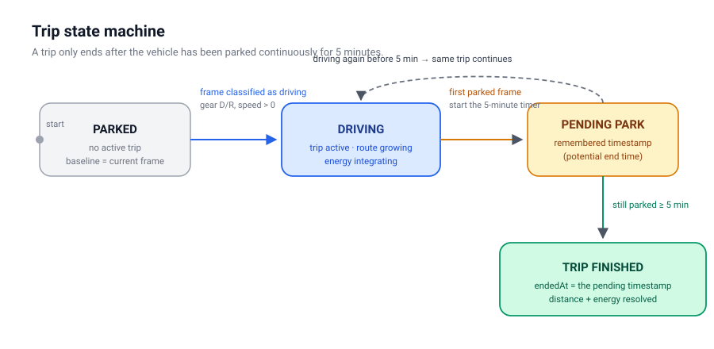

# EV Trip Recorder

**A vehicle-agnostic algorithm for recording EV trips**: it consumes normalized telemetry frames and produces trip records (start/end places, distance, duration, energy, route).

It is designed for the "server records, phone only reads" setup — the car may sit parked while the phone app is closed, so on-device recording is guaranteed to miss trips.

```
telemetry ──► motion ──► trip state machine ──► distance fusion ──► energy ──► trip record
  10 s        gear/speed     5-minute parking       odometer/GPS     integration
```

Zero dependencies, plain JavaScript (ESM), Node ≥ 18.



## Why use it

| Common approach | What breaks |
| :--- | :--- |
| Finish the trip on the first parked frame | Traffic lights and kerbside drop-offs split one drive into 7–8 trips |
| Use only the odometer | Integer kilometres: a 0.7 km leg reads as 0 or 1 |
| Use only the cloud cumulative energy counter | Integer kWh: a 2 km trip can "consume" 6 kWh — physically impossible |
| Use only GPS distance | Loses points in tunnels, inflates while stationary |

Each of those cases is handled explicitly (see below).

## Quick start

```bash
npm test      # 9 cases: start/end, distance fusion, energy, frame gaps
npm run demo  # one full synthetic trip
```

```js
import { TripRecorder } from 'ev-trip-recorder';

const recorder = new TripRecorder({
  onTripFinished: (trip) => saveToDatabase(trip),
});

// Feed one frame per poll (10 s while driving, 30-120 s while parked)
recorder.observe({
  timestamp: Date.now(),
  gear: 'D',
  speed: 42,
  powered: true,
  odometerKm: 21_503,
  batteryVoltageV: 349.6,
  batteryCurrentA: 45,
  location: { latitude: 24.9, longitude: 102.7 },
  cumulativeEnergyKwh: 2893,
});

console.log(recorder.list());
```

## How it works

### 1. Motion classification: gear → speed → power state

The order mirrors the head-unit logic. Gear alone is not enough — some models have no `P` position, or the gear signal can be missing.

| Order | Condition | Result |
| :--- | :--- | :--- |
| 1 | gear `P` / `PARK` / `0` | parked |
| 2 | gear `D` / `R` / `1` / `3` | driving |
| 3 | speed > 0 (and < 1000) | driving |
| 4 | `powered === false` | parked |
| 5 | otherwise | parked (conservative) |

### 2. Trip start: the first driving frame

As soon as a frame is classified as driving and no trip is active, a trip starts. The start position comes from the last parked frame, which is closer to where the car actually left from.

### 3. Trip end: 5 minutes of continuous parking

```
first parked frame   → remember its timestamp ("pending")
still parked         → has stableParkingMs elapsed?
  ├ yes              → finish the trip; endedAt = the pending timestamp
  └ driving again     → clear pending; the same trip continues
```

`endedAt` is the moment parking began, so the waiting window is never counted into the duration.

Five minutes covers traffic lights (< 2 min) and kerbside drop-offs (< 3 min).

### 4. Distance fusion: odometer for long trips, GPS for short ones

| Source | Accuracy | Blind spot |
| :--- | :--- | :--- |
| Odometer | ±0.5 km (integer) | short trips collapse to zero |
| GPS track | ±30 m | tunnels, stationary drift |

```
odometer delta ≥ 3 km                       → odometer
odometer < 3 km and |GPS − odometer| ≤ 1 km  → GPS (keeps the decimal)
odometer resolvable (≥ 0.5 km)              → odometer
otherwise GPS ≥ 0.3 km                      → GPS
```

Each record carries `distanceSource` (`ODOMETER` / `GPS`) for debugging.

### 5. Energy: integration first, calibrated by the cumulative counter

Two independent sources:

- **V × I integration** — `power = voltage × current`, trapezoidal per frame. Decimal precision, but with a systematic bias.
- **Cloud cumulative energy** — integer kWh, unbiased over time, catastrophic for short trips (±0.5 kWh is ±150% on 0.7 km).

Strategy:

```
short trip (< 2 km): integrated value × learned correction factor
long trip (≥ 2 km) : cumulative delta, guarded by a plausibility check
both available     : k = cumulative delta / integrated, median of the last 20 samples,
                     used as the correction factor for future short trips
```

Plausibility gate: implied consumption must stay within `1 – 80 kWh/100 km`.
Short trips with A/C legitimately exceed 40, so the ceiling is 80; this only rejects order-of-magnitude errors.

### 6. Frame gaps and completeness

If two consecutive frames are more than `frameGapMs` (default 10 min) apart, the trip is marked `PARTIAL`. In that case distance prefers the odometer — GPS cannot see the unobserved segment.

### 7. Route

Points closer than `routeMinSpacingMeters` (default 8 m) are dropped; first and last are always kept.

## Sampling cadence

The algorithm does not enforce a cadence, but the interval **directly controls distance and energy error**.
These are the values we actually run on our own server (tune them to your API quota):

| Situation | Interval | Why |
| :--- | :--- | :--- |
| **Driving** | **10 s** | Distance comes from the GPS track and energy from V x I integration; both are time-sampled. Longer intervals miss accelerations. 10 s balances accuracy and request volume (6 req/min) |
| **Parked, still recording** | **30 s** | The only job here is confirming that the car really stopped. A 5-minute confirmation only needs a few samples |
| **Long parking** | **120 s** | Nothing changes. Two minutes keeps power and API quota low |

### Three rules of thumb

1. **Never go beyond 60 s while driving.** V x I integration then systematically under-reports
   (high-power segments are skipped entirely); a 40 km trip can lose more than 10% of its energy.
2. **Parked polling must stay below one fifth of `stableParkingMs`.** With the default 5 minute
   confirmation, keep parked sampling at 60 s or less — otherwise the trip appears in the list
   several minutes late (its `endedAt` is still correct, but the delay is confusing).
3. **If the API is rate-limited, slow down the parking phase, not the driving phase.**
   Extra parked samples are worthless; missing driving samples cost accuracy.

### What sparse sampling costs (rough estimates, not measurements)

| Driving interval | Distance error (GPS, short trip) | Energy error (V x I) | Frame-gap risk |
| :--- | :--- | :--- | :--- |
| 10 s | ±2% | ±5% | none |
| 30 s | ±5% | ±10% | none |
| 60 s | ±10% | ±15% | none |
| 5 min | ±20% | — | starts to produce `PARTIAL` |

> `PARTIAL` is driven by `frameGapMs` (default 10 minutes): when two consecutive frames are further
> apart, distance falls back to the odometer instead of trusting an incomplete GPS track.

### Cadence is independent of the data source

As long as your source emits a reliable `timestamp`, cadence is a pure policy decision —
switching cars or APIs does not require touching the algorithm.

## API

### `new TripRecorder(options)`

| Option | Default | Meaning |
| :--- | :--- | :--- |
| `stableParkingMs` | `5 * 60_000` | continuous parking required to end a trip |
| `frameGapMs` | `10 * 60_000` | frame-gap threshold |
| `routeMinSpacingMeters` | `8` | minimum route point spacing |
| `retainDays` | `30` | retention window |
| `minElectricalCoverageRatio` | `0.5` | integration coverage below this is not trusted |
| `store` | in-memory | persistence container `{ trips, runtime, save() }` |
| `onTripFinished` | `null` | callback per finished trip |

### Methods

| Method | Description |
| :--- | :--- |
| `observe(frame)` | Feed one frame; returns `{ started?, finished? }` |
| `list()` | Trips, newest first |
| `cleanup(now)` | Drop trips older than the retention window |

### Exported helpers

`classifyMotion`, `haversineMeters`, `pathLengthMeters`, `fuseDistance`, `simplifyByDistance`, `integrateEnergy`, `powerW`, `clampCalibration`, `medianCalibration`, `isPlausibleCumulative`.

TypeScript definitions ship in `index.d.ts`.

## Record shape

```json
{
  "tripId": "trip_m3k2_ab12cd",
  "startedAt": 1800000000000,
  "endedAt": 1800002400000,
  "durationMinutes": 40,
  "distanceKm": 12,
  "distanceSource": "ODOMETER",
  "gpsDistanceMeters": 11870,
  "energyKwh": 2.4,
  "energySource": "INTEGRATED",
  "completeness": "COMPLETE",
  "maxFrameGapMs": 0,
  "route": [{ "latitude": 24.9, "longitude": 102.7, "timestamp": 1800000000000, "speedKmh": 34 }]
}
```

## Connecting your own car

Normalize whatever source you have into the `frame` object:

1. polling the manufacturer cloud API (tokens usually expire fast — plan for renewal);
2. MQTT from a telematics box;
3. a Bluetooth OBD dongle.

See "Sampling cadence" below for the full breakdown.

## License

MIT
